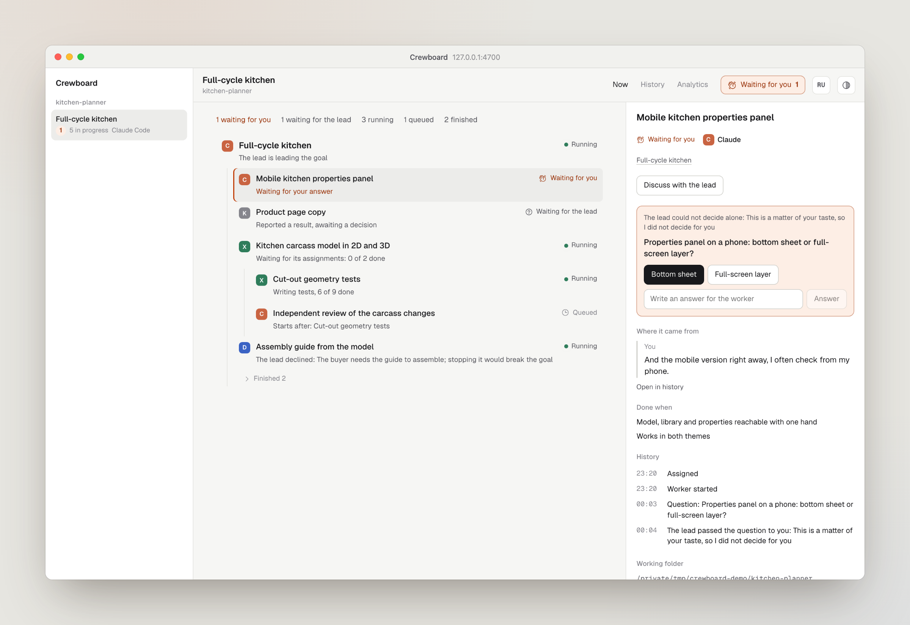
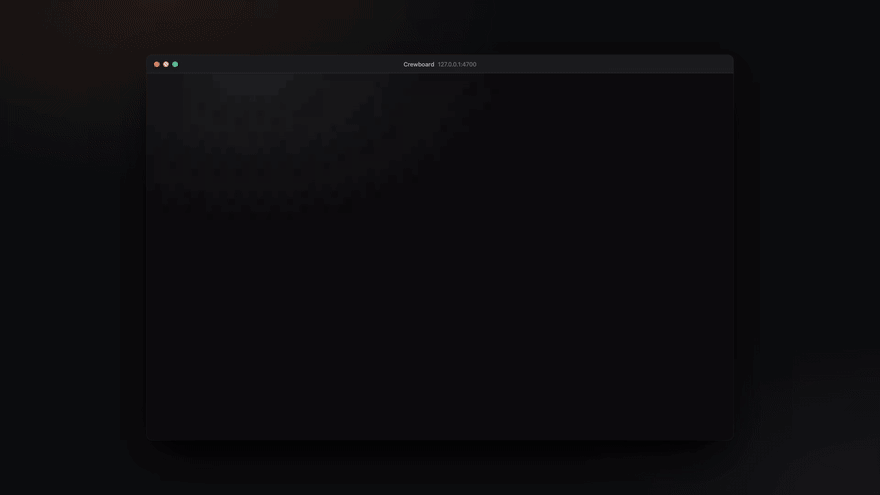

# Crewboard

**English** | [Русский](README.ru.md)

[](https://github.com/Kjaly/crewboard/actions/workflows/ci.yml)
[](LICENSE)

**Lead your coding agents from one chat, and see what they are doing.**

You talk to one lead chat: Claude Code, Codex, dsh or any MCP client. It hands work through Crewboard to Codex, Claude, DeepSeek or any agent you register, Kimi and GLM through dsh included, answers their questions, and closes their work against the criteria you agreed on. Crewboard is the local screen beside it: what is happening right now, who does what, the conversation it came from, and what it cost.

<picture>
  <source media="(prefers-color-scheme: dark)" srcset="docs/assets/en/now-dark.png">
  
</picture>

[](docs/assets/en/walkthrough.mp4)

Documentation: **[kjaly.github.io/crewboard](https://kjaly.github.io/crewboard/)** (the same guides as [`docs/`](docs/README.md), with search).

## How it works

1. **You agree with the lead on what you want.** In your lead chat, describe the goal; the lead asks what it needs and settles the criteria for done with you.
2. **The lead hands out the work.** Through Crewboard's MCP tools it starts a goal and assigns pieces to Codex, Claude or DeepSeek. Each assignment remembers who gave it, what it should produce and the message it came from.
3. **Workers ask the lead first.** A worker's question goes to the lead. Only what the lead cannot decide (taste, scope, money) reaches you, on the screen.
4. **The lead closes the work.** It checks each result against the criteria and closes it or sends it back. You do not accept work; you can step in at any time.
5. **You steer from the tree.** Ask to clarify, stop, hand over to another provider, start early or reopen. Every action is a request the lead decides; its decision is final, and you argue with it in chat.

## Install

Once the `crewboard` package is on npm (Node.js 24+):

```sh
npx crewboard serve
```

Until then, from a source checkout (Node.js 24+, pnpm 11.5.2, Git):

```sh
git clone https://github.com/Kjaly/crewboard.git
cd crewboard
pnpm install --frozen-lockfile
pnpm build
node packages/crewboard/dist/main.js serve
```

Open http://127.0.0.1:4700/. The screen shows which workers are ready and how to connect your lead, any MCP client. From the terminal, the same in two commands:

```sh
crewboard doctor           # which workers can run here, and what to install for the rest
crewboard connect claude   # or: codex, dsh, other
```

From a source checkout, `crewboard` is `node packages/crewboard/dist/main.js`.

Then, in your lead chat inside one of your repositories, describe what you want. The [getting started guide](docs/en/getting-started.md) walks through the first goal.

## What you need for each worker

| Worker | What it needs |
| --- | --- |
| Codex | `codex` CLI, signed in (`codex login`) |
| Claude | `claude` CLI and `ANTHROPIC_API_KEY` (automated runs use an API key, not a subscription) |
| DeepSeek | `dsh` (DeepSeek Harness) with a DeepSeek key in its settings |

See [workers](docs/en/workers.md) for models, defaults and how a worker splits its own work.

## Documentation

- [Getting started](docs/en/getting-started.md)
- [The lead](docs/en/lead.md): MCP tools, waiting for news, questions and requests
- [Workers](docs/en/workers.md)
- [The screen](docs/en/screen.md): Now, requests from the tree, History, Analytics
- [Costs](docs/en/costs.md)
- [Troubleshooting](docs/en/troubleshooting.md)
- [Architecture](docs/architecture.md) · [Contributing](CONTRIBUTING.md) · [Security](SECURITY.md) · [Changelog](CHANGELOG.md)

## Status

Version 1.1.0. Used on macOS with Claude Code, Codex CLI and DeepSeek Harness. Linux should work; Windows is untested. The server listens on 127.0.0.1 only and has no login of its own: see [security](SECURITY.md).
