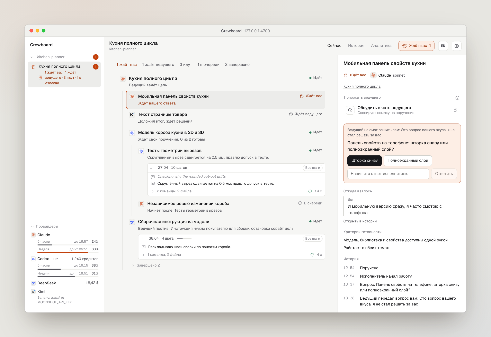
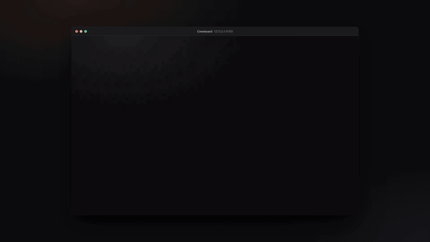

# Crewboard

[English](README.md) | **Русский**

[](https://github.com/Kjaly/crewboard/actions/workflows/ci.yml)
[](LICENSE)

**Ведите агентов из одного чата и следите, что они делают.**

Вы разговариваете с одним ведущим чатом (Claude Code). Через Crewboard он раздаёт работу Codex, Claude и DeepSeek, отвечает на их вопросы и закрывает работу по критериям, о которых вы договорились. Crewboard — это локальный экран рядом: что происходит прямо сейчас, кто чем занят, из какого разговора это выросло и сколько стоило.

<picture>
  <source media="(prefers-color-scheme: dark)" srcset="docs/assets/ru/now-dark.png">
  
</picture>

[](docs/assets/ru/walkthrough.mp4)

Документация: **[kjaly.github.io/crewboard/ru](https://kjaly.github.io/crewboard/ru/)** (те же руководства, что в [`docs/`](docs/README.md), с поиском).

## Как это работает

1. **Вы договариваетесь с ведущим, что хотите получить.** В Claude Code опишите цель. Ведущий спросит, что ему нужно, и вместе с вами определит критерии готовности.
2. **Ведущий раздаёт работу.** Инструментами Crewboard по MCP он ставит цель и поручает части Codex, Claude или DeepSeek. Каждое поручение помнит, кто его дал, что должно получиться и из какой реплики оно родилось.
3. **Исполнители сначала спрашивают ведущего.** Вопрос исполнителя уходит ведущему. До вас доходит только то, что ведущий решить не может: вкус, объём работы, деньги.
4. **Ведущий закрывает работу.** Он сверяет итог с критериями и закрывает его или возвращает с замечанием. Принимать работу вам не нужно, но вмешаться можно в любой момент.
5. **Вы управляете из дерева.** Попросите уточнить, остановить, передать другому провайдеру, начать раньше или переоткрыть. Каждое действие — просьба к ведущему. Его решение окончательное, спорить с ним можно в чате.

## Установка

Из исходников (Node.js 24+, pnpm 11.5.2, Git):

```sh
git clone https://github.com/Kjaly/crewboard.git
cd crewboard
pnpm install --frozen-lockfile
pnpm build
node packages/crewboard/dist/main.js serve
```

Откройте http://127.0.0.1:4700/ и подключите Claude Code как ведущего:

```sh
claude mcp add --transport http crewboard http://127.0.0.1:4700/mcp
```

Дальше в чате Claude Code внутри одного из ваших репозиториев опишите, что хотите. [Руководство по началу работы](docs/ru/getting-started.md) проводит через первую цель.

## Что нужно каждому исполнителю

| Исполнитель | Что нужно |
| --- | --- |
| Codex | CLI `codex`, вход выполнен (`codex login`) |
| Claude | CLI `claude` и `ANTHROPIC_API_KEY` (автоматические запуски идут по ключу API, не по подписке) |
| DeepSeek | `dsh` (DeepSeek Harness) с ключом DeepSeek в его настройках |

Модели, значения по умолчанию и то, как исполнитель сам делит работу, описаны в [руководстве по исполнителям](docs/ru/workers.md).

## Документация

- [Начало работы](docs/ru/getting-started.md)
- [Ведущий](docs/ru/lead.md): инструменты MCP, ожидание новостей, вопросы и просьбы
- [Исполнители](docs/ru/workers.md)
- [Экран](docs/ru/screen.md): «Сейчас», просьбы из дерева, «История», «Аналитика»
- [Затраты](docs/ru/costs.md)
- [Если что-то не так](docs/ru/troubleshooting.md)
- [Архитектура](docs/architecture.md) · [Как помочь проекту](CONTRIBUTING.md) · [Безопасность](SECURITY.md) · [Изменения](CHANGELOG.md)

## Состояние

Версия 1.0.0. Используется на macOS с Claude Code, Codex CLI и DeepSeek Harness. На Linux должно работать, на Windows не проверялось. Сервер слушает только 127.0.0.1 и своей авторизации не имеет, подробнее в разделе о [безопасности](SECURITY.md).
