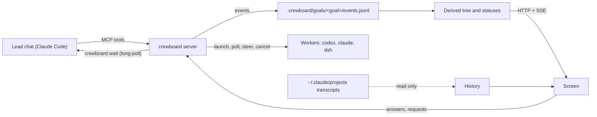

# Architecture

Crewboard is one local Node.js process: an HTTP server that the lead talks to over MCP, that runs workers, and that serves the screen.

## Packages

| Package | Responsibility |
| --- | --- |
| `packages/crewboard` | The product, published as `crewboard`: the journal, the supervisor, the lead's MCP tools, the HTTP API with live updates, the React screen. |
| `packages/core` | Private, bundled into `crewboard`: worker backends for the Claude and Codex CLIs and for dsh, their detached run supervisors, event normalising, cost readers. |

## Data flow

## Journal

Every goal is an append-only journal of events: goal started, assigned, run started and ended (with cost), progress, question, escalated, answered, steered, reported, returned, closed, cancelled, reassigned, reopened, owner requested, request decided. Appends to a goal are serialised in the process and numbered; a line cut short by a crash is skipped on read.

Statuses are never stored. `buildTree` derives each node's status from its own events and its parent's status: queued, running, waiting for the lead, waiting for the owner, done, cancelled, abandoned, and paused for a goal whose lead is silent. The same derivation feeds the screen, the lead's `crewboard_status` and the supervisor.

## Supervisor

Every two seconds, and right after a new assignment, the supervisor walks each goal of each registered repository. It starts queued work whose dependencies are done, reads every open run through core's `RunBackend`, records progress, turns the worker's last message into a result, a question or a split, and resumes a worker whose split-off parts all finished. A launch the backend refuses is recorded as a failed run. Each project's ticks and the lead's commands run through one queue, so a run is never started twice.

## The lead

The MCP server is the lead's only way in. It has no separate planning model: the lead chat decides, Crewboard records and carries out. Requests from the screen are journal events the lead reads in its inbox; accepting one carries out the action in the same step as the decision. `crewboard wait` long-polls the inbox so the lead's background command wakes it.

## The screen

A React 18 bundle served by the same process. It reads `/api/projects`, `/api/goals/:id` and friends, and subscribes to `/api/live` (server-sent events) for journal appends; bursts are coalesced into one refresh per 250 ms. Writes from the screen (answers, requests, emergency stop) accept only JSON from the same origin.

## History

The history tab reads Claude Code's transcripts, never writes them. A goal's sessions are the transcript files, in the repository's folder or its subfolders' folders under `~/.claude/projects`, that call a `crewboard_*` tool with that goal. Lines Claude Code injects itself (`isMeta`, compaction summaries, notifications) are not the owner's words and are left out.

## Trust

The server listens on 127.0.0.1 and has no login: any local process can use it. Workers run with the permissions of the user who started the server, in the repository or in worktrees under `.crewboard/worktrees/`. See [security](../SECURITY.md).
