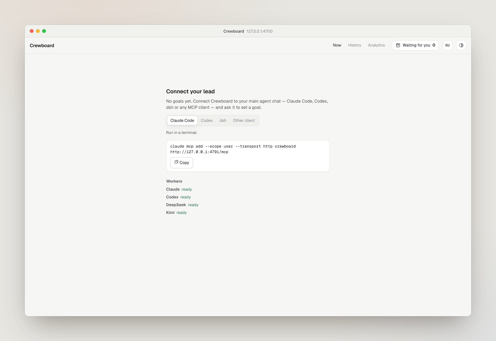

# Getting started

**English** | [Русский](../ru/getting-started.md)

This guide takes you from a fresh checkout to a first goal that a worker finishes.

## 1. Install and start the server

You need Node.js 22.15 or newer.

```sh
npx crewboard serve
```

Or install it once with `npm install -g crewboard`, and `crewboard serve` from then on. To run from source instead, you also need pnpm 11.5.2 and Git:

```sh
git clone https://github.com/Kjaly/crewboard.git
cd crewboard
pnpm install --frozen-lockfile
pnpm build
node packages/crewboard/dist/main.js serve
```

The server prints its address:

```text
crewboard http://127.0.0.1:4700  mcp: http://127.0.0.1:4700/mcp
```

`--port` picks another port. The server listens on 127.0.0.1 only. `--open` opens the screen in your browser once the server listens; `--version` prints the version. Once it listens, it also prints which workers are ready, for example `workers ready: Codex, Claude · not ready: DeepSeek (not found)`.

From a source checkout, to call it `crewboard` in this shell session, define a function with the checkout's absolute path. The rest of the docs write `crewboard`.

```sh
CREWBOARD_MAIN="$PWD/packages/crewboard/dist/main.js"
crewboard() { node "$CREWBOARD_MAIN" "$@"; }
```

## 2. Open the screen

Open http://127.0.0.1:4700/. With no goals yet, the screen shows how to connect a lead, for each known client, with a copy button, and which workers are ready on this machine.

<picture>
  <source media="(prefers-color-scheme: dark)" srcset="../assets/en/empty-dark.png">
  
</picture>

## 3. Connect your lead

The lead is your usual agent chat. Any MCP client can lead; connect the one you use. `crewboard connect claude` or `crewboard connect codex` runs the command below for you; `crewboard connect dsh` and `crewboard connect other` print what to add.

Claude Code:

```sh
claude mcp add --scope user --transport http crewboard http://127.0.0.1:4700/mcp
```

Or the Crewboard plugin for Claude Code, which connects the same server and adds a skill for leading. In a Claude Code chat (2.1.275 or later) run `/plugin install crewboard --marketplace Kjaly/crewboard`, or from a terminal `claude plugin marketplace add Kjaly/crewboard` and then `claude plugin install crewboard@crewboard`. Use the plugin or `claude mcp add`, not both.

Codex:

```sh
codex mcp add crewboard --url http://127.0.0.1:4700/mcp
```

dsh: add the server to your dsh profile with the `@deepseek-ai/dsh-mcp-client` module:

```yaml
- name: '@deepseek-ai/dsh-mcp-client'
  config:
    serverName: crewboard
    transport: streamable-http
    url: http://127.0.0.1:4700/mcp
```

Any other MCP client: add a Streamable HTTP server at `http://127.0.0.1:4700/mcp`.

The lead now has Crewboard's tools and reads its instructions on how to lead. You do not need to explain the protocol to it.

## 4. Set up at least one worker

Run `crewboard doctor`: it lists each worker as ready, or says what to install or sign in to. Codex is the quickest: install the `codex` CLI and run `codex login`. Claude is ready once you are signed in to Claude Code; DeepSeek needs `dsh` with a DeepSeek key. See [workers](workers.md).

## 5. Start your first goal

Open your lead chat inside one of your Git repositories and describe what you want, for example:

> Add a Usage section to the README. Ask Codex to draft it.

The lead asks what it needs, agrees on the criteria with you, starts a goal and assigns the work. On the screen the goal appears in the sidebar under your repository, and the tree shows the assignment with what the worker is doing right now.

The lead keeps `crewboard wait` running in the background, so it wakes up when a worker asks something or finishes. When the worker reports, the lead checks the result against the criteria and closes it; the node turns to **Done**.

## 6. If a worker asks you

When the lead cannot answer a worker's question itself, it raises it to you. **Waiting for you** in the header lights up; open it, pick an option or write your answer. The worker continues with it, and the lead hears your answer too.

## Where things are kept

- Each repository's goals live in `<repo>/.crewboard/` (ignored by Git through its own `.gitignore`).
- The list of known repositories is `~/.crewboard/projects.json`; `CREWBOARD_HOME` moves it.
- The history tab reads Claude Code's own transcripts from `~/.claude/projects` and never writes there.

Next: [the lead](lead.md) and [the screen](screen.md).
