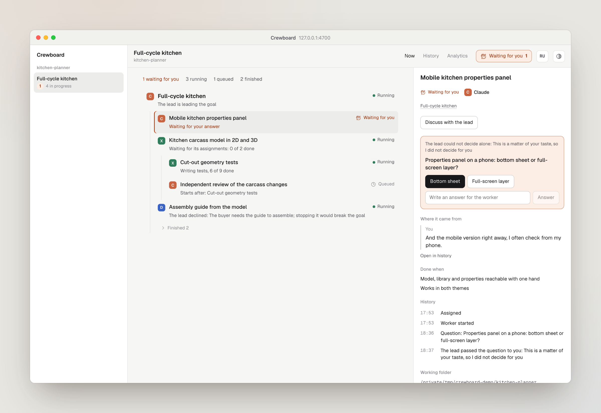

<figure>
<picture>
  <source media="(prefers-color-scheme: dark)" srcset="../assets/en/now-dark.png">
  
</picture>
</figure>
<figure>
<video src="../assets/en/walkthrough.mp4" autoplay muted loop playsinline aria-label="Walkthrough: answering a worker's question, asking the lead to hand work over, the history and the analytics."></video>
<figcaption>Answer a worker, ask the lead to hand work over, read the history and the costs.</figcaption>
</figure>

