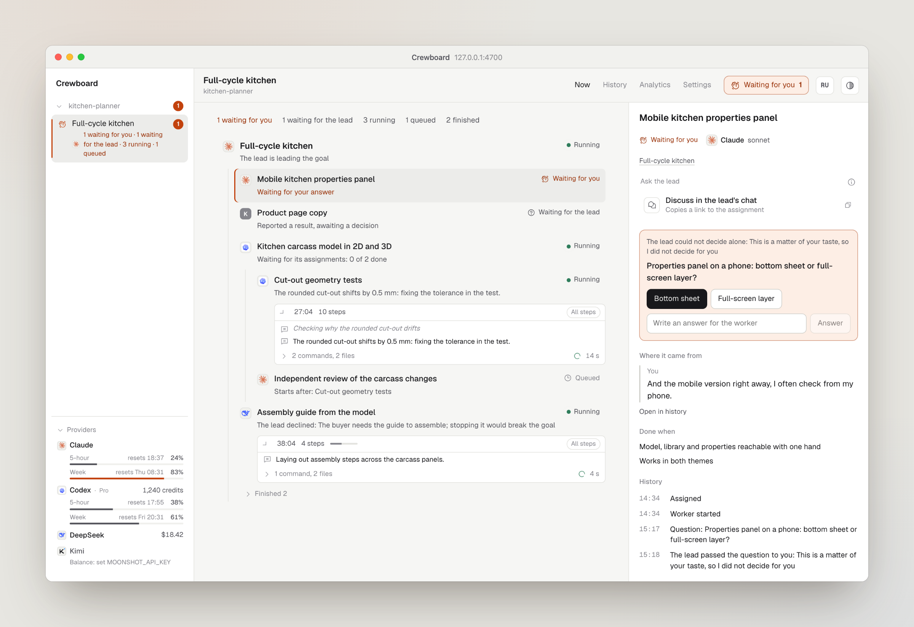
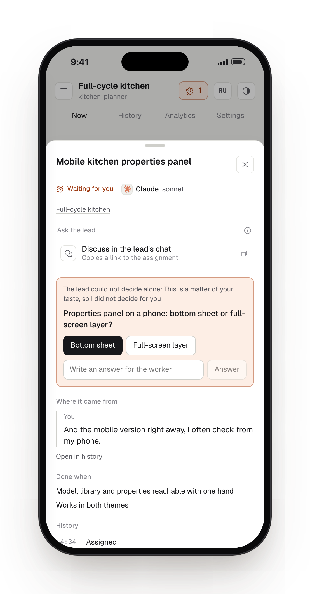
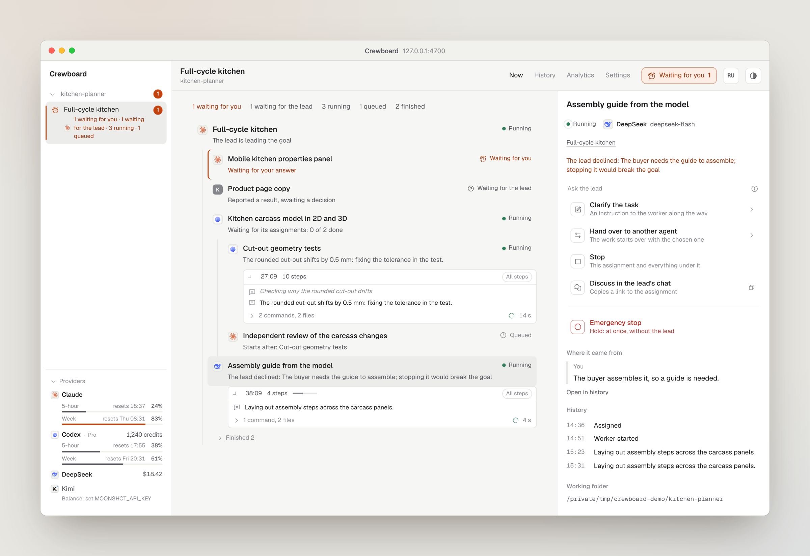
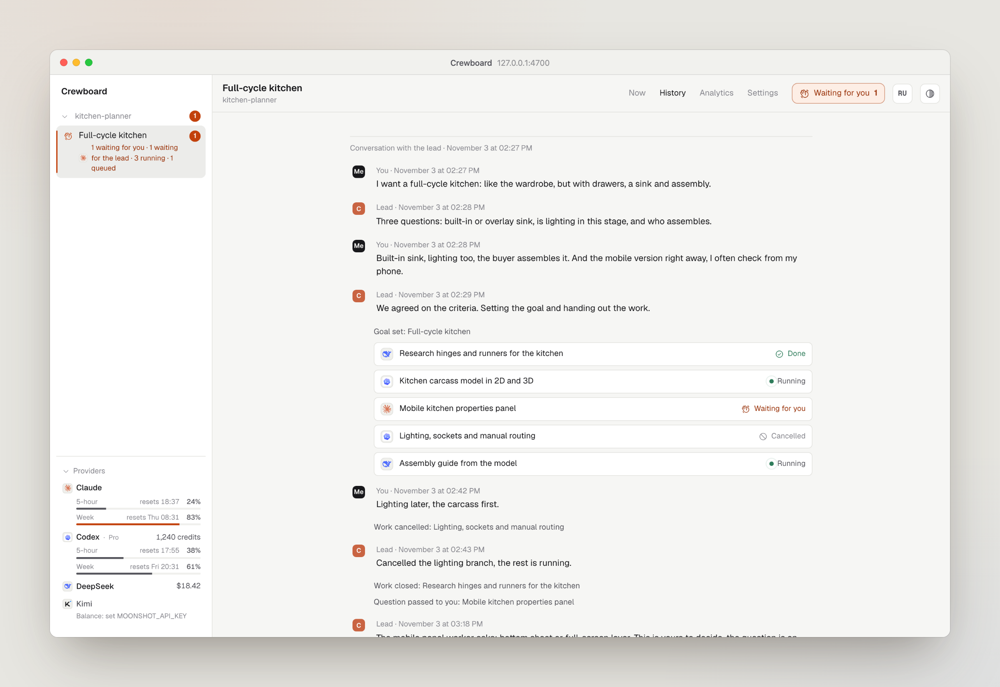
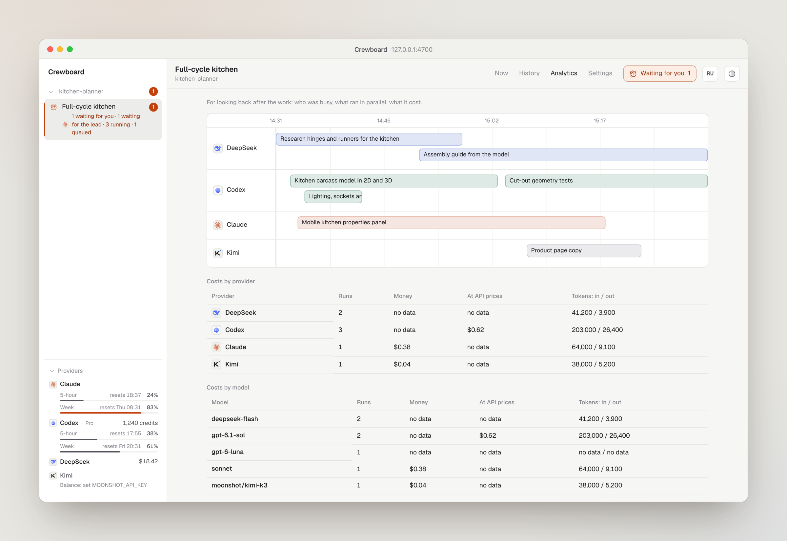

# The screen

**English** | [Русский](../ru/screen.md)

The screen is at http://127.0.0.1:4700/. It follows the lead's work live; there is nothing to refresh. It speaks English and Russian: it follows your browser's language, and the **RU** / **EN** button in the header switches it.

## Sidebar

Every repository Crewboard knows, with its goals underneath. Each goal is one conversation with the lead. A project folds with its caret and keeps a badge of what waits for you even when folded. Each goal shows a mark for its state (running, waiting for you with a count, waiting for the lead, paused, finished), its lead's logo and a short line such as "2 running, 1 waiting for you". Goals that wait for you come first, then running ones; finished goals fold under **Finished N**. Folded projects and groups are remembered. On a narrow screen the sidebar opens from the header.

### Providers

At the foot of the sidebar, each provider your agents run on with what is left of it. Crewboard stores nothing here and asks again at most once a minute.

- **Codex**: your plan and how much of each limit window is used, with when it resets, read from Codex's own session files in `~/.codex/sessions`, plus the credit balance. The numbers are as of Codex's last run.
- **Claude**: your plan and the 5-hour and weekly limits (and per-model weekly ones where your plan has them), the same numbers as the Claude app. Crewboard asks the endpoint Claude Code itself uses with Claude Code's sign-in, read from the macOS Keychain or `~/.claude/.credentials.json` for that request only: never stored, logged or sent anywhere but `api.anthropic.com`. On macOS the first read asks for Keychain access; **Always Allow** keeps it quiet. The endpoint is not documented by Anthropic, so if it refuses or changes, Crewboard falls back to what a status line logged: install once with `npm install -g crewboard` and set `"statusLine": {"type": "command", "command": "crewboard statusline"}` in `~/.claude/settings.json`; it prints the model and both limits and logs each change to `~/.claude/usage/rate-limits.jsonl` (`CREWBOARD_CLAUDE_LIMITS` moves it). `CREWBOARD_CLAUDE_USAGE=log` uses only the log and never reads the sign-in. On an API key there are no limits to show.
- **DeepSeek** and **Kimi**: the money left, from each provider's balance API, with the key from `DEEPSEEK_API_KEY` or `MOONSHOT_API_KEY` in the server's environment. Without a key the row says which variable to set. `DEEPSEEK_BASE_URL` and `MOONSHOT_BASE_URL` point at a mirror or proxy; Kimi on `api.moonshot.cn` shows the balance in yuan.

A bar turns orange past 70% and red past 90%; a provider that refuses work shows **Limit reached**. `CREWBOARD_NO_USAGE=1` turns the panel off and reads nothing.

**Waiting for you** in the header counts what waits for you across all projects and jumps to the first such node.

## Now

<picture>
  <source media="(prefers-color-scheme: dark)" srcset="../assets/en/now-dark.png">
  
</picture>

- **Summary**: how many nodes wait for you, wait for the lead, run, are queued and are finished.
- **Tree**: the goal at the root, assignments under whoever gave them, each with its agent's logo. What waits for you comes first; finished work folds into **Finished N**. Under each node: what it is doing right now.
- **Run feed** under a running node: what the worker says it is doing, as it happens. Its short messages and, for Codex, its thoughts are the main lines; the commands and files between them fold into one line such as "5 commands, 2 files" that opens with a click, and **All steps** shows every step. Commands are shown without shell wrappers and absolute paths. It has three sizes (one line, the last three steps, up to 300 px with scrolling) and remembers yours per node. It follows new steps unless you scrolled up, says **silent for N min** when the worker has written nothing for five minutes, and folds into a one-line summary when the run ends.
- **Context** of the selected node: the request or question if there is one, the actions, who assigned it, **Where it came from** (the owner's message) with **Open in history**, the criteria, the parts inside it, its history and its working copy.

On a phone the context opens as a sheet from the bottom.

<picture class="phone">
  <source media="(prefers-color-scheme: dark)" srcset="../assets/en/mobile-dark.png">
  
</picture>

### Statuses

| On screen | Meaning |
| --- | --- |
| Queued | assigned, not started yet; it may wait for another assignment |
| Running | a worker is at it |
| Waiting for the lead | the worker asked, reported, or its run failed: the lead's move |
| Waiting for you | the lead raised a question to you |
| Reported | a part a worker split off has handed its result to that worker; it turns Done when the lead closes the parent |
| Done | the lead closed it against the criteria |
| Cancelled | stopped, with the reason |
| Abandoned | its parent finished, or nothing happened for a day after its run ended |
| Paused | the goal's lead has been silent for a day |

## Requests from the tree

<picture>
  <source media="(prefers-color-scheme: dark)" srcset="../assets/en/request-dark.png">
  
</picture>

Under **Ask the lead**, each action is a row with what it does. They are requests, not commands: the lead decides, and the node shows "Requested: …. The lead is deciding", then the result, or "The lead declined: …" with the reason. The actions follow the status:

| On screen | Offered when |
| --- | --- |
| Clarify the task, Stop | the work runs or waits for the lead |
| Start sooner, Cancel | it is queued |
| Hand over to another agent | it runs, waits for the lead or is queued |
| Reopen | it is done |
| Bring back | it was cancelled or abandoned, and its parent is not finished |
| Discuss in the lead's chat | always |

**Clarify the task**, **Reopen** and **Bring back** open a text field in place: **⌘/Ctrl Enter** sends, **Esc** closes.

**Hand over to another agent** lists the agent doing the work first, marked **now**, to move it to another model or effort, then every other agent from the [registry](workers.md#your-agents), each with its logo and a chip showing the model and effort it will get. The chip opens a card next to it: the agent's models (the default marked, keys **1–9**, or any other model by name) and its effort levels as a stepped meter, or a note when the agent takes no effort. **Reset** restores the initial picker values. **Default** in the effort section removes the assignment override and uses the agent default, or the CLI default when the agent has none. This works for the same agent too. An accepted handoff of queued work changes the assignment without launching it; dependencies stay in place.

**Discuss in the lead's chat** copies a ready message about the node to paste into the chat, and lets the lead know.

**Emergency stop** sits apart, below the requests, on any running work: press and hold it. It stops the run at once without waiting for the lead, and the lead hears about it in its inbox. While the lead is offline, the screen notes that a request may get no answer.

### Keys

With the tree focused: **↑ ↓** move, **U** clarify, **S** stop, **P** hand over, **C** discuss. **Esc** closes the sheet. The letters work on any keyboard layout.

## History

<picture>
  <source media="(prefers-color-scheme: dark)" srcset="../assets/en/history-dark.png">
  
</picture>

The whole conversation with the lead, read from the lead's own transcripts (Claude Code, Codex or dsh): your messages, the lead's answers, assignments as cards with their live status (a card opens the node), and the lead's other tool calls folded into a count. Text the client injects itself (skill bodies, environment blocks, notifications, compaction summaries) is left out. Every chat that touched the goal is shown, in order, even when a different client took the goal over.

For a lead whose transcripts Crewboard cannot read, the tab shows the course of the work from Crewboard's own journal instead, and says so: your messages it saw, the lead's assignments and decisions, and each takeover with the new lead's name.

## Analytics

<picture>
  <source media="(prefers-color-scheme: dark)" srcset="../assets/en/analytics-dark.png">
  
</picture>

For looking back: one lane per provider with each run over time, and costs by provider, model and assignment. The model table groups each run by its saved launch model, including runs across different providers. Older journals use the model from the run's agent id; if it is unavailable, the row says “no data”. Money, API-price estimates, subscription runs and missing data follow the same rules in both tables. See [costs](costs.md).

## Settings

The **Settings** tab next to Now, History and Analytics works even before you create a goal. Each agent has its logo, default model and effort, and an enabled switch. Choose a model from the same catalog as the handoff picker; effort choices follow that model's declared levels (including Codex's own levels). **Default** removes the configured effort so the CLI decides. Refresh requests an updated catalog; a failed request leaves registry suggestions usable and offers a retry.

The preset rows let you change the agent, model, effort and note, add a named preset, or disable one. **Agent default** leaves the preset's model unset; **Default** effort inherits the agent/CLI default. An explicit model/effort in an assignment can override the preset. The built-in presets and file format are described under [workers](workers.md#presets).

Press **Save changes** to apply all edits. Changes affect future runs; existing run snapshots keep their model and effort. Crewboard saves the old file as `agents.json.bak`. If another editor changed the file since you opened settings, saving returns **409** and the screen reloads the latest settings; reapply your edits. **Reload** also discards unsaved edits and reads the file again. Settings follow the current theme and fit narrow screens.
