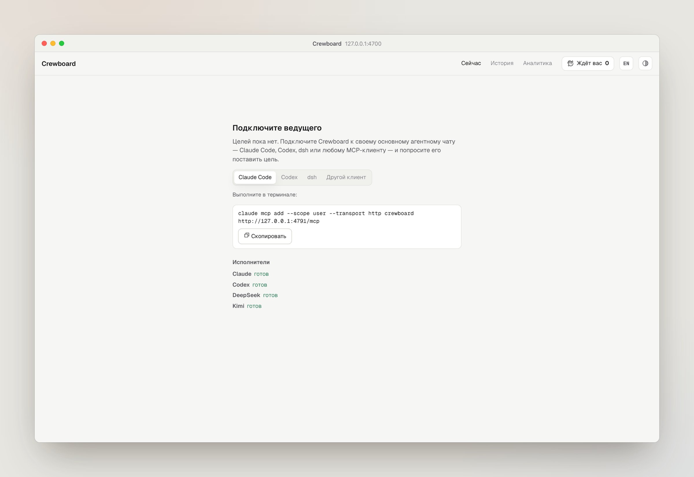

# Начало работы

[English](../en/getting-started.md) | **Русский**

Это руководство проводит от свежего клона репозитория до первой цели, которую выполнил исполнитель.

## 1. Установите и запустите сервер

Нужен Node.js 24 или новее.

```sh
npx crewboard serve
```

Или установите один раз командой `npm install -g crewboard` и дальше запускайте `crewboard serve`. Чтобы запускать из исходников, нужны ещё pnpm 11.5.2 и Git:

```sh
git clone https://github.com/Kjaly/crewboard.git
cd crewboard
pnpm install --frozen-lockfile
pnpm build
node packages/crewboard/dist/main.js serve
```

Сервер напишет свой адрес:

```text
crewboard http://127.0.0.1:4700  mcp: http://127.0.0.1:4700/mcp
```

Флаг `--port` выбирает другой порт. Сервер слушает только 127.0.0.1. Когда порт открыт, сервер также пишет, какие исполнители готовы, например `workers ready: Codex, Claude · not ready: DeepSeek (not found)`.

При запуске из исходников, чтобы вызывать его командой `crewboard` в текущей сессии оболочки, объявите функцию с абсолютным путём к клону. Дальше в документации пишется просто `crewboard`.

```sh
CREWBOARD_MAIN="$PWD/packages/crewboard/dist/main.js"
crewboard() { node "$CREWBOARD_MAIN" "$@"; }
```

## 2. Откройте экран

Откройте http://127.0.0.1:4700/. Пока целей нет, экран показывает, как подключить ведущего, для каждого известного клиента, с кнопкой «Скопировать», и какие исполнители готовы на этой машине.

<picture>
  <source media="(prefers-color-scheme: dark)" srcset="../assets/ru/empty-dark.png">
  
</picture>

## 3. Подключите ведущего

Ведущий — ваш привычный агентный чат. Вести может любой MCP-клиент; подключите тот, которым пользуетесь. `crewboard connect claude` или `crewboard connect codex` выполнит команду ниже за вас; `crewboard connect dsh` и `crewboard connect other` напечатают, что добавить.

Claude Code:

```sh
claude mcp add --scope user --transport http crewboard http://127.0.0.1:4700/mcp
```

Codex:

```sh
codex mcp add crewboard --url http://127.0.0.1:4700/mcp
```

dsh: добавьте сервер в профиль dsh модулем `@deepseek-ai/dsh-mcp-client`:

```yaml
- name: '@deepseek-ai/dsh-mcp-client'
  config:
    serverName: crewboard
    transport: streamable-http
    url: http://127.0.0.1:4700/mcp
```

Любой другой MCP-клиент: добавьте сервер Streamable HTTP по адресу `http://127.0.0.1:4700/mcp`.

Теперь у ведущего есть инструменты Crewboard и инструкция, как вести работу. Объяснять ему протокол не нужно.

## 4. Настройте хотя бы одного исполнителя

Выполните `crewboard doctor`: он покажет каждого исполнителя готовым или скажет, что поставить или куда войти. Быстрее всего с Codex: установите CLI `codex` и выполните `codex login`. Claude готов, если вы вошли в Claude Code, DeepSeek нужен `dsh` с ключом DeepSeek. Подробнее в руководстве по [исполнителям](workers.md).

## 5. Поставьте первую цель

Откройте чат ведущего внутри одного из своих Git-репозиториев и опишите, что хотите. Например:

> Добавь в README раздел Usage. Пусть черновик напишет Codex.

Ведущий спросит, что ему нужно, договорится с вами о критериях, поставит цель и раздаст работу. На экране цель появится в боковой панели под вашим репозиторием, а в дереве будет видно поручение и то, чем исполнитель занят прямо сейчас.

Ведущий держит в фоне `crewboard wait`, поэтому просыпается, когда исполнитель спрашивает или заканчивает. Когда исполнитель сдаёт итог, ведущий сверяет его с критериями и закрывает. Узел становится «Готово».

## 6. Если исполнитель спрашивает вас

Когда ведущий не может ответить на вопрос исполнителя сам, он передаёт его вам. В шапке загорается «Ждёт вас». Откройте вопрос, выберите вариант или напишите свой ответ. Исполнитель продолжит с ним, а ведущий тоже узнает ваш ответ.

## Где что хранится

- Цели каждого репозитория лежат в `<repo>/.crewboard/`. Git их не видит благодаря собственному `.gitignore` в этой папке.
- Список известных репозиториев — `~/.crewboard/projects.json`. Переменная `CREWBOARD_HOME` переносит его в другое место.
- Вкладка «История» читает транскрипты самого Claude Code из `~/.claude/projects` и ничего туда не пишет.

Дальше: [ведущий](lead.md) и [экран](screen.md).
