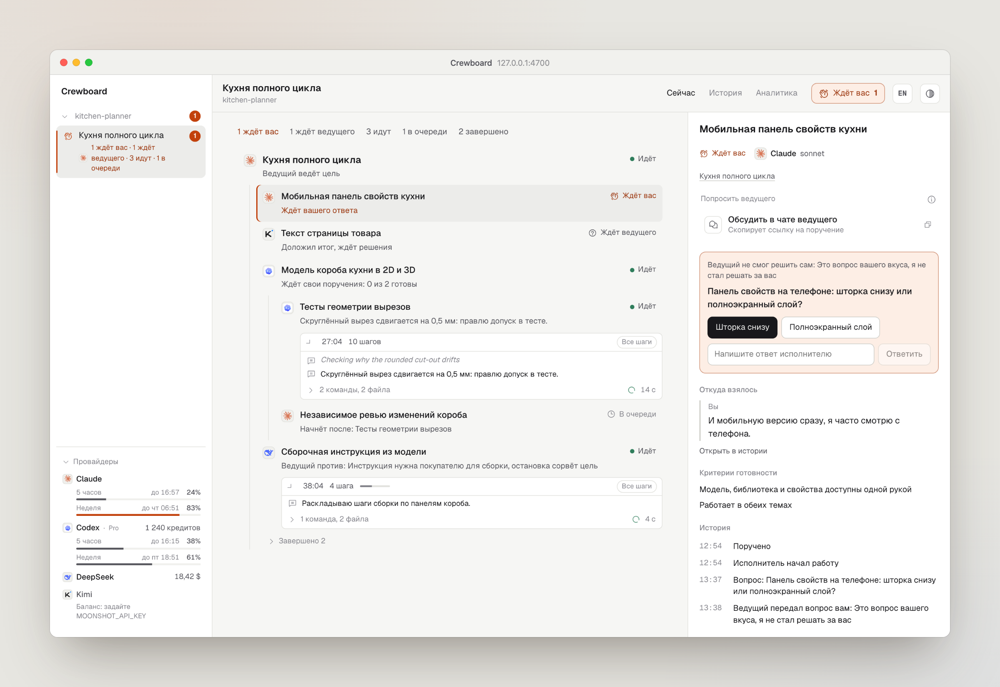

<figure>
<picture>
  <source media="(prefers-color-scheme: dark)" srcset="../assets/ru/now-dark.png">
  
</picture>
</figure>
<figure>
<video src="../assets/ru/walkthrough.mp4" autoplay muted loop playsinline aria-label="Проход: ответ на вопрос исполнителя, просьба передать работу, история и аналитика."></video>
<figcaption>Ответьте исполнителю, попросите ведущего передать работу, загляните в историю и затраты.</figcaption>
</figure>

