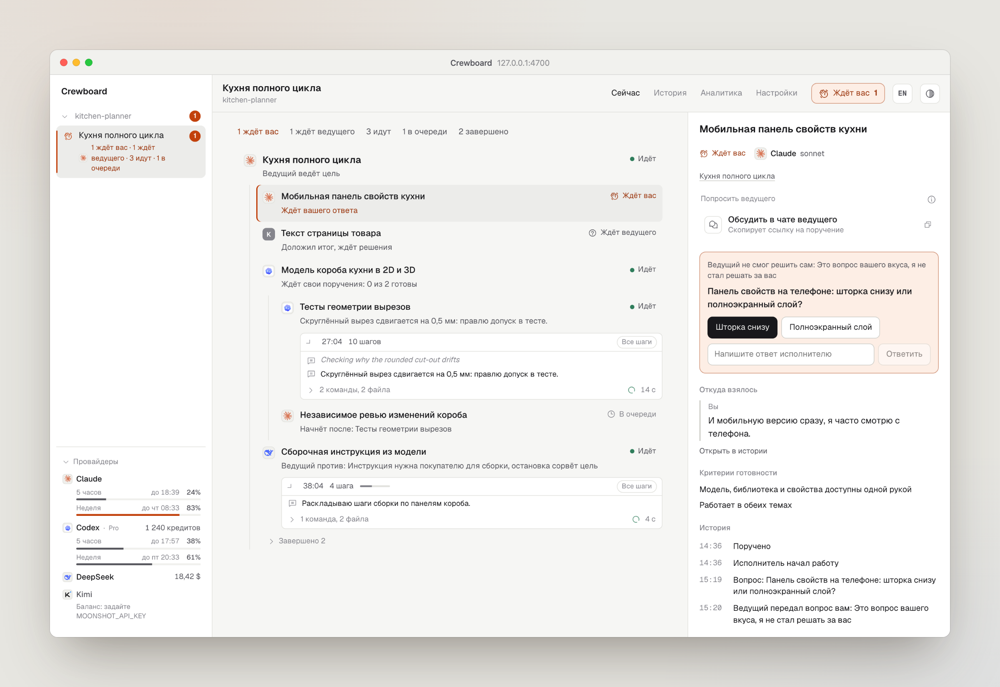
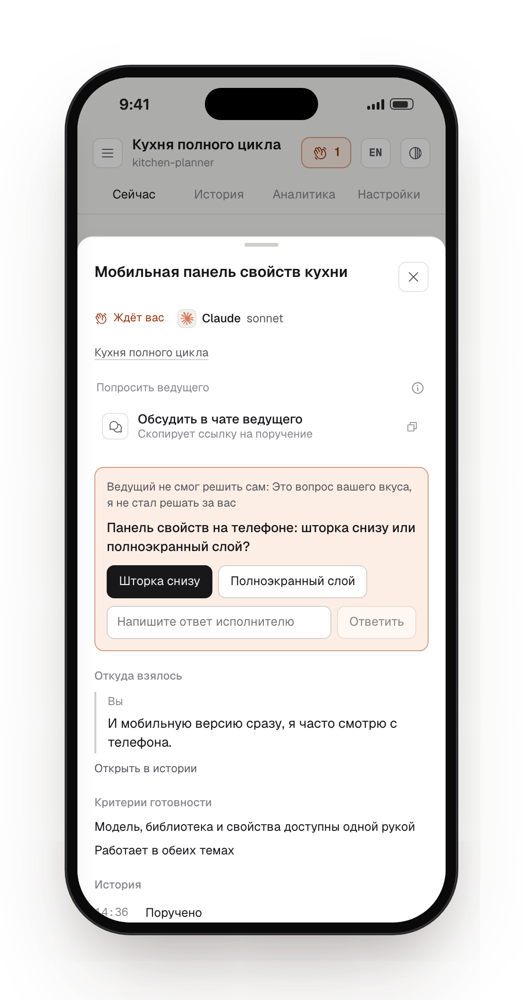
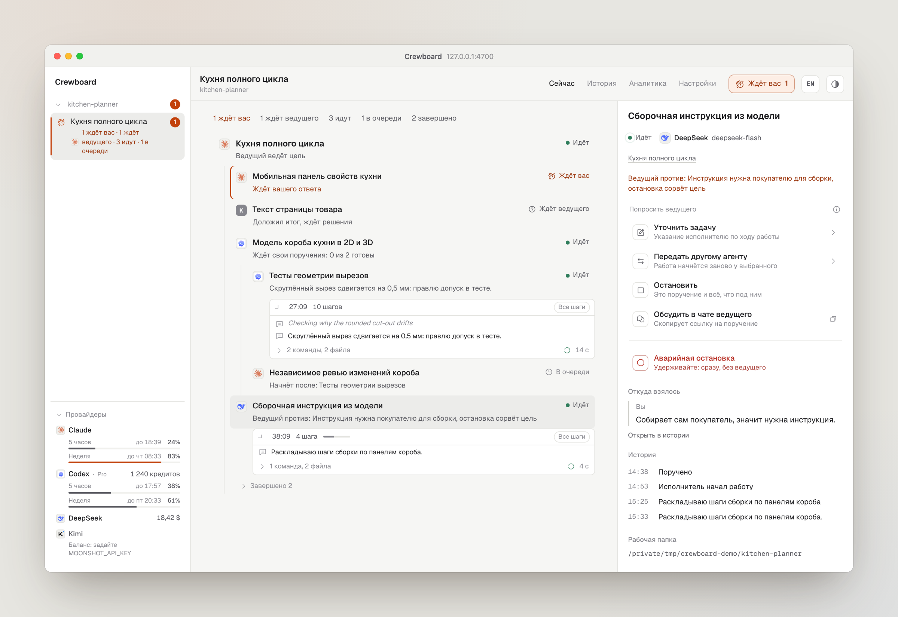
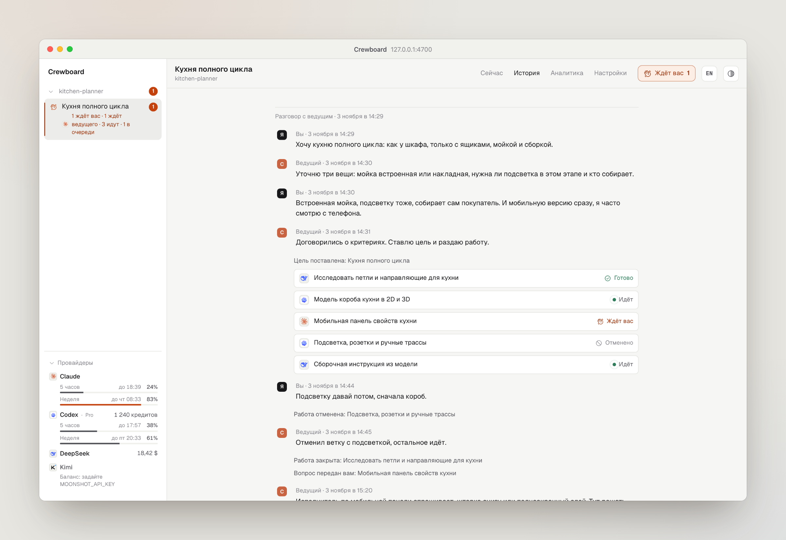
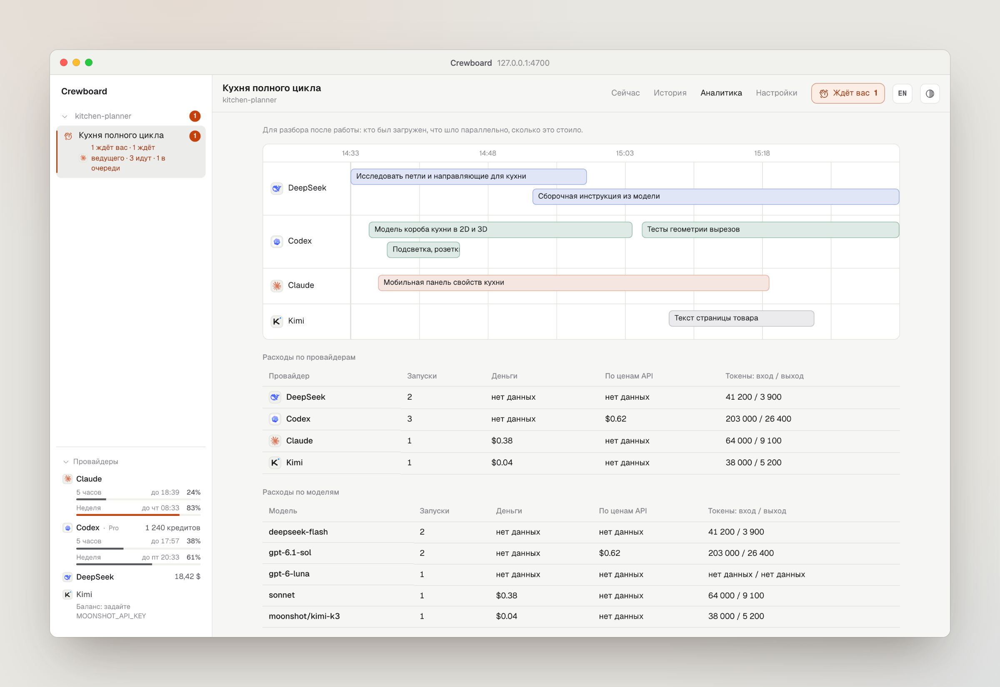

# Экран

[English](../en/screen.md) | **Русский**

Экран открывается по адресу http://127.0.0.1:4700/. Он следит за работой ведущего в реальном времени, обновлять ничего не нужно. Интерфейс говорит по-русски и по-английски: язык берётся из браузера, а кнопка **EN** / **RU** в шапке переключает его.

## Боковая панель

Все репозитории, которые знает Crewboard, и их цели. Каждая цель — отдельный разговор с ведущим. Проект сворачивается стрелкой, а значок того, что ждёт вас, виден и у свёрнутого. У каждой цели значок состояния (идёт, ждёт вас с числом, ждёт ведущего, на паузе, завершено), логотип её ведущего и короткая строка вроде «2 идут, 1 ждёт вас». Сначала идут цели, которые ждут вас, потом те, что в работе; завершённые свёрнуты в «Завершено N». Свёрнутые проекты и группы запоминаются. На узком экране панель открывается кнопкой в шапке.

### Провайдеры

Внизу боковой панели — каждый провайдер, на котором работают ваши агенты, и сколько у него осталось. Crewboard ничего здесь не хранит и спрашивает заново не чаще раза в минуту.

- **Codex**: ваш тариф, сколько использовано в каждом окне лимита и когда оно сбросится, — из собственных файлов сессий Codex в `~/.codex/sessions`, плюс остаток кредитов. Цифры на момент последнего запуска Codex.
- **Claude**: ваш тариф и лимиты на 5 часов и на неделю (и недельные по моделям, если они есть в тарифе) — те же цифры, что в приложении Claude. Crewboard спрашивает их у того же адреса, что и сам Claude Code, с его входом, который читается из Связки ключей macOS или `~/.claude/.credentials.json` только для этого запроса: он нигде не хранится, не пишется в логи и уходит только на `api.anthropic.com`. На macOS при первом чтении система спросит доступ к Связке ключей; «Разрешать всегда» убирает вопрос. Anthropic этот адрес не документирует, поэтому если он откажет или изменится, Crewboard берёт то, что записала statusline: один раз установите `npm install -g crewboard` и задайте в `~/.claude/settings.json` `"statusLine": {"type": "command", "command": "crewboard statusline"}`; она печатает модель и оба лимита и записывает каждое изменение в `~/.claude/usage/rate-limits.jsonl` (переменная `CREWBOARD_CLAUDE_LIMITS` переносит файл). `CREWBOARD_CLAUDE_USAGE=log` берёт только лог и вход не читает. С API-ключом лимитов нет.
- **DeepSeek** и **Kimi**: остаток денег из API баланса провайдера, с ключом из `DEEPSEEK_API_KEY` или `MOONSHOT_API_KEY` в окружении сервера. Без ключа строка подскажет, какую переменную задать. `DEEPSEEK_BASE_URL` и `MOONSHOT_BASE_URL` направляют запрос на зеркало или прокси; Kimi на `api.moonshot.cn` показывает баланс в юанях.

Полоска становится оранжевой после 70% и красной после 90%; провайдер, который отказывает в работе, показывает «Лимит исчерпан». `CREWBOARD_NO_USAGE=1` выключает панель, и тогда ничего не читается.

Кнопка «Ждёт вас» в шапке считает всё, что ждёт вас во всех проектах, и переходит к первому такому узлу.

## «Сейчас»

<picture>
  <source media="(prefers-color-scheme: dark)" srcset="../assets/ru/now-dark.png">
  
</picture>

- **Сводка**: сколько узлов ждут вас, ждут ведущего, идут, стоят в очереди и завершены.
- **Дерево**: цель в корне, поручения под тем, кто их дал, у каждого логотип его агента. Сначала то, что ждёт вас. Завершённое свёрнуто в «Завершено N». Под каждым узлом строка о том, чем он занят прямо сейчас.
- **Лента хода работы** под идущим поручением: что исполнитель сам пишет о своей работе, по мере того как это происходит. Его короткие реплики и, у Codex, его мысли — главные строки; команды и файлы между ними сворачиваются в одну строку вроде «5 команд, 2 файла», которая раскрывается по клику, а «Все шаги» показывает всё подряд. Команды показываются без обёрток оболочки и абсолютных путей. У ленты три размера (одна строка, последние три шага, до 300 px с прокруткой), выбранный запоминается для каждого узла. Лента следует за новыми шагами, если вы не пролистали вверх, пишет «молчит N мин», когда исполнитель пять минут ничего не пишет, и после конца запуска сворачивается в одну строку.
- **Контекст** выбранного узла: просьба или вопрос, если есть, действия, кто поручил, «Откуда взялось» — реплика владельца — со ссылкой «Открыть в истории», критерии, части внутри, история узла и его рабочая папка.

На телефоне контекст выезжает шторкой снизу.

<picture class="phone">
  <source media="(prefers-color-scheme: dark)" srcset="../assets/ru/mobile-dark.png">
  
</picture>

### Статусы

| На экране | Что значит |
| --- | --- |
| В очереди | поручено, ещё не начато; может ждать другое поручение |
| Идёт | исполнитель работает |
| Ждёт ведущего | исполнитель спросил, сдал итог или его запуск упал: ход за ведущим |
| Ждёт вас | ведущий передал вам вопрос |
| Доложено | часть, которую выделил исполнитель, отдала ему свой итог; станет «Готово», когда ведущий закроет родителя |
| Готово | ведущий закрыл по критериям |
| Отменено | остановлено, с причиной |
| Брошено | родитель закончился, или сутки ничего не происходило после конца запуска |
| На паузе | ведущий цели молчит больше суток |

## Просьбы из дерева

<picture>
  <source media="(prefers-color-scheme: dark)" srcset="../assets/ru/request-dark.png">
  
</picture>

В блоке «Попросить ведущего» каждое действие — строка с пояснением, что оно сделает. Это просьбы, а не команды: решает ведущий, а узел показывает «Запрошено: …. Ведущий решает», потом результат или «Ведущий против: …» с причиной. Действия зависят от статуса:

| На экране | Когда доступно |
| --- | --- |
| Уточнить задачу, Остановить | работа идёт или ждёт ведущего |
| Начать раньше, Отменить | работа в очереди |
| Передать другому агенту | работа идёт, ждёт ведущего или стоит в очереди |
| Переоткрыть | работа готова |
| Вернуть в работу | работа отменена или брошена, а её родитель не закончен |
| Обсудить в чате ведущего | всегда |

«Уточнить задачу», «Переоткрыть» и «Вернуть в работу» открывают поле для текста прямо на месте: **⌘/Ctrl Enter** отправляет, **Esc** закрывает.

«Передать другому агенту» показывает первым агента, который делает работу, с пометкой «сейчас»: так можно сменить ему модель или effort. Дальше идут все остальные агенты из [реестра](workers.md#ваши-агенты), у каждого логотип и капсулой: какую модель и effort получит работа. Капсула открывает рядом карточку: модели агента (основная отмечена, клавиши **1–9**, можно вписать любую другую) и уровни effort ступенчатой шкалой, либо пояснение, если агент effort не принимает. «Сбросить» возвращает исходный выбор карточки. «По умолчанию» в разделе effort снимает override поручения: берётся умолчание агента, а если его нет — CLI. Это работает и для того же агента. Принятая передача работы в очереди меняет назначение без запуска; зависимости сохраняются.

«Обсудить в чате ведущего» копирует готовую реплику про узел, чтобы вставить её в чат, и сообщает ведущему.

«Аварийная остановка» стоит отдельно, под просьбами, на любой идущей работе: её нужно нажать и удерживать. Она останавливает запуск сразу, не дожидаясь ведущего, а ведущий узнаёт о ней из входящих. Пока ведущий не на связи, экран предупреждает, что ответа на просьбу может не быть.

### Клавиши

Когда фокус в дереве: **↑ ↓** — перемещение, **U** — уточнить, **S** — остановить, **P** — передать, **C** — обсудить. **Esc** закрывает шторку. Буквы работают на любой раскладке.

## «История»

<picture>
  <source media="(prefers-color-scheme: dark)" srcset="../assets/ru/history-dark.png">
  
</picture>

Весь разговор с ведущим из его собственных транскриптов (Claude Code, Codex или dsh): ваши реплики, ответы ведущего, поручения карточками с живым статусом (карточка открывает узел), прочие вызовы инструментов свёрнуты в счётчик. Текст, который вставляет сам клиент (тела скиллов, блоки окружения, уведомления, сводки после сжатия), не показывается. Видны все чаты, которые касались цели, по порядку, даже если цель подхватил другой клиент.

Для ведущего, чьи транскрипты Crewboard прочитать не может, вкладка показывает ход работы из собственного журнала Crewboard и прямо об этом пишет: ваши реплики, которые он видел, поручения и решения ведущего и каждую смену ведущего с именем нового.

## «Аналитика»

<picture>
  <source media="(prefers-color-scheme: dark)" srcset="../assets/ru/analytics-dark.png">
  
</picture>

Для разбора после работы: по дорожке на провайдера с каждым запуском во времени и расходы по провайдерам, моделям и поручениям. Таблица моделей группирует запуски по модели, сохранённой при запуске, в том числе у разных провайдеров. Для старых журналов модель берётся из идентификатора агента запуска; если её узнать нельзя, строка называется «нет данных». Деньги, оценки по ценам API, запуски по подписке и отсутствие данных учитываются по одинаковым правилам в обеих таблицах. Подробнее в разделе о [затратах](costs.md).

## «Настройки»

Вкладка «Настройки» рядом с «Сейчас», «Историей» и «Аналитикой» доступна ещё до создания цели. У каждого агента есть логотип, модель и effort по умолчанию, переключатель включения. Модель выбирается из того же каталога, что при передаче; уровни effort берутся из выбранной модели, когда она их объявляет (включая уровни самого Codex). «По умолчанию» снимает настроенный effort, оставляя выбор CLI. Обновление запрашивает свежий каталог; при ошибке остаются подсказки реестра и кнопка повторной загрузки.

В строках пресетов можно сменить агента, модель, effort и заметку, добавить именованный пресет или выключить его. «Умолчание агента» оставляет модель пресета незаданной; effort «По умолчанию» наследует умолчание агента/CLI. Явные модель/effort при назначении могут перекрыть пресет. Встроенные пресеты и формат файла описаны в разделе [исполнителей](workers.md#пресеты).

«Сохранить» применяет все правки. Изменения касаются будущих запусков; снимки уже начатых сохраняют модель и effort. Crewboard оставляет прежний файл в `agents.json.bak`. Если другой редактор изменил файл после открытия настроек, сохранение возвращает **409**, а экран перечитывает актуальные настройки; внесите правки заново. «Перечитать» также сбрасывает несохранённые правки и читает файл снова. Настройки поддерживают текущую тему и узкий экран.
